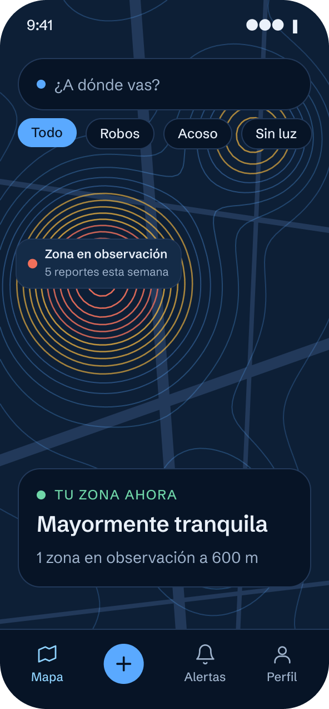
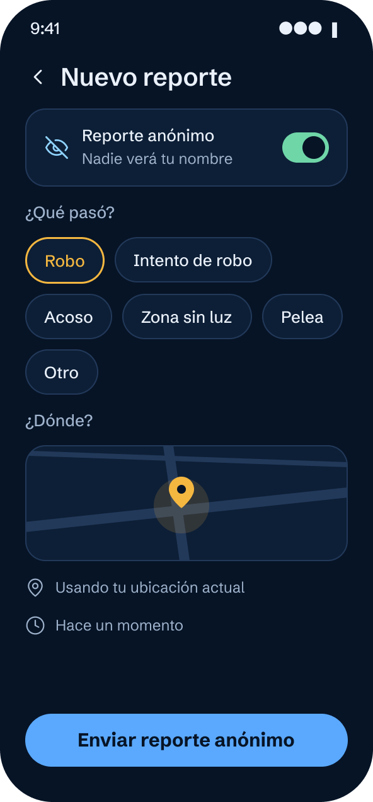
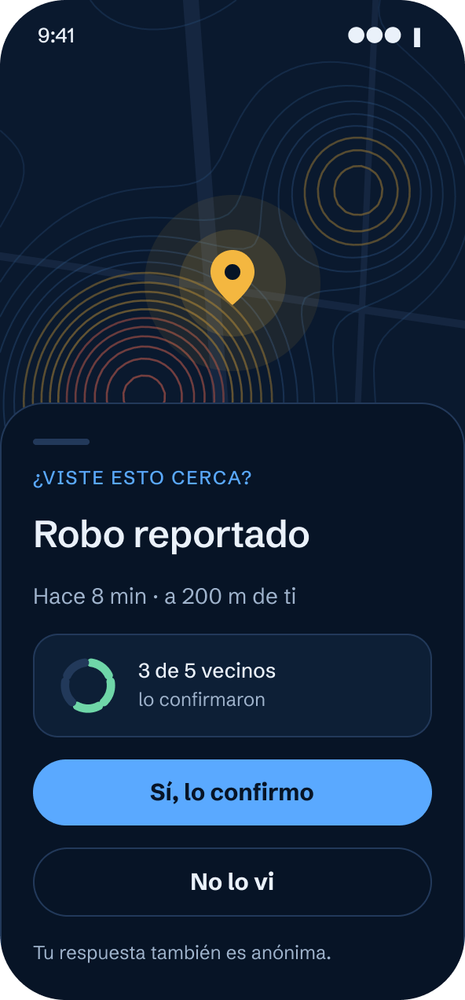
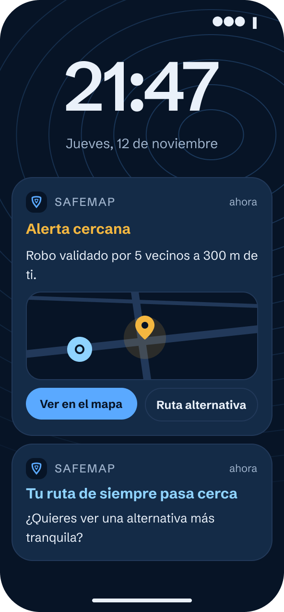
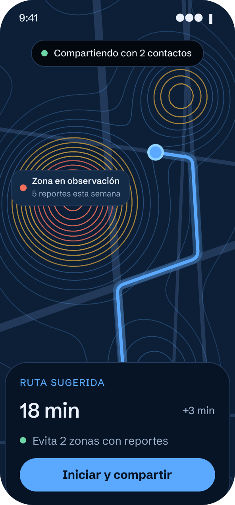
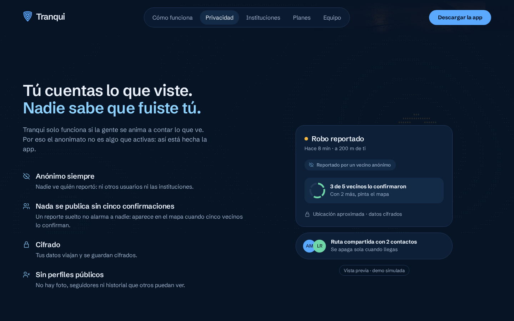

<p align="center">
  <a href="https://tranqui.jahattrinidad.com/">
    
  </a>
</p>

<h1 align="center">Tranqui · Landing</h1>

<p align="center">
  Reportes anónimos que tus vecinos validan: mira qué pasa en tu zona, recibe alertas cerca de ti y elige por dónde ir.
</p>

<p align="center">
  <a href="https://tranqui.jahattrinidad.com/"><strong>tranqui.jahattrinidad.com</strong></a>
</p>

<p align="center">
  <a href="https://github.com/trinity-bytes/tranqui/actions/workflows/deploy.yml"></a>
  <a href="https://github.com/trinity-bytes/tranqui/releases"></a>
  
  
</p>

---

## Qué es

Landing informativa del proyecto académico **Tranqui**. Presenta la app, cómo funciona, su modelo de privacidad, los planes y el equipo. Es un sitio estático hecho con Astro 7 y Tailwind 4, sin runtime de React. La app Flutter vive en otro repositorio.

<p align="center">
  
</p>

## Cómo funciona la app

<table>
  <tr>
    <td align="center" width="20%"><br><sub><b>Mira tu zona</b></sub></td>
    <td align="center" width="20%"><br><sub><b>Reporta</b></sub></td>
    <td align="center" width="20%"><br><sub><b>Tus vecinos validan</b></sub></td>
    <td align="center" width="20%"><br><sub><b>Recibe alertas</b></sub></td>
    <td align="center" width="20%"><br><sub><b>Elige por dónde ir</b></sub></td>
  </tr>
</table>

<sub>Pantallas de demostración: mapas y cifras son ejemplos.</sub>

## La landing

<table>
  <tr>
    <td width="68%"></td>
    <td width="32%"></td>
  </tr>
</table>

- **Campo de glifos** animado en canvas, que reacciona al cursor y al click.
- **Narrativa con scroll**: cuatro pasos con el teléfono fijo; sin JavaScript o en pantallas bajas se leen apilados.
- **Accesible**: menú con `<dialog>` nativo, FAQ con `<details>` y respeto por `prefers-reduced-motion`.
- **Imágenes optimizadas**: Astro y Sharp generan AVIF y WebP en el build.

## Desarrollo

Requisitos: Node.js 22.23.4 o superior y npm.

```sh
npm ci
npm run dev
```

Abre `http://localhost:4321/`.

> [!NOTE]
> En Linux x64 sin AVX2 (CPUs anteriores a 2013), el compilador nativo de Astro 7 termina con `Illegal instruction`. El `postinstall` (`scripts/astro-compiler-fallback.mjs`) lo detecta y usa la versión WASI oficial del mismo compilador; en el resto de equipos y en CI no hace nada. Con `npm ci --ignore-scripts` ese paso no corre y, en esas CPUs, el build falla.

## Verificación

Ejecuta los comandos de a uno, no en paralelo: el entorno de desarrollo tiene unos 3 GB de RAM.

```sh
npm run lint
NODE_OPTIONS=--max-old-space-size=768 npm run type-check
node --test --test-concurrency=1 tests/build-wrapper.test.mjs tests/astro-compiler-fallback.test.mjs
npm run build
npm run preview
```

`build` limita el heap de Node a 768 MiB y el pool de imágenes a un hilo, y conserva los argumentos de Astro (`npm run build -- --outDir /tmp/tranqui-preview`). El primer build tarda más por las imágenes; los siguientes reutilizan caché.

<details>
<summary><b>Tests de navegador (Playwright)</b></summary>

Instala Chromium una vez con `npx playwright install chromium`. Con `npm run preview` activo, ejecuta **un script por vez**:

```sh
node tests/navigation.mjs
node tests/glyph-field.mjs
node tests/narrative.mjs
node tests/trust-content.mjs
node tests/closing-content.mjs
node tests/integration.mjs
node tests/metadata.mjs
```

- `TEST_URL` cambia la URL de prueba.
- `PLAYWRIGHT_CHROMIUM_EXECUTABLE_PATH` usa un Chromium ya instalado.
- `QA_SCREENSHOT_DIR` guarda capturas del test de integración fuera del repositorio.

[Informe observado](docs/landing-qa/README.md).

</details>

## Estructura

```text
src/
├── components/
│   ├── sections/   secciones de la landing
│   ├── ui/         primitivas, campo de glifos y capa de movimiento
│   └── layout/     header, diálogo mobile y footer
├── assets/landing/ fotos, retratos, pantallas y SVG aprobados
└── layouts/        BaseLayout con metadata y social cards
docs/
├── landing-spec/   copy, medidas y capturas originales de Figma
├── previews/       imágenes de vista previa (GitHub, Figma)
└── readme/         capturas de este README
odd/tasks/          plan de implementación, decisiones y evidencia
```

## Despliegue

Cada push a `main` publica en GitHub Pages, en el dominio `tranqui.jahattrinidad.com`. El trabajo se integra en `develop` y llega a `main` con un release de git-flow. Detalles en [DEPLOYMENT.md](DEPLOYMENT.md).

## Contenido pendiente

Todavía no hay enlace de Google Play, páginas legales, enlaces del equipo ni destino de contacto aprobado, y no se publican destinos ficticios: el badge de Google Play está inactivo. Figma tiene seis preguntas frecuentes y solo la primera respuesta; las otras cinco quedan en los datos con `answer: null`, fuera de la página pública. Las metas no se presentan como logros.
